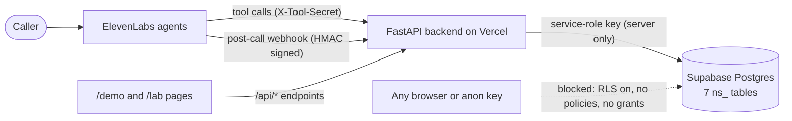
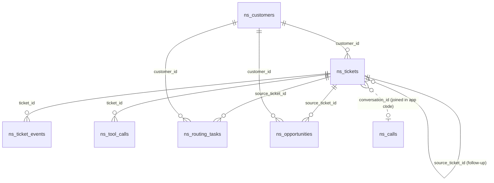

# Supabase backend

NightAgent keeps its records in Supabase Postgres. The ElevenLabs agents (Sam and the specialists) reach the FastAPI backend through tool calls and a post-call webhook, and the backend is the **only** thing that talks to the database. This page covers the tables, how access is locked down, how the schema is applied, and how the tables share a Supabase project with another app.

## How the pieces connect

Nothing in the browser, the ElevenLabs agent config, or the repo holds a database credential. The backend holds one, in server environment variables only.

## Tables

All tables live in the `public` schema with an `ns_` prefix (see [Why the `ns_` prefix](#why-the-ns_-prefix)).

| Table | One row per |
|---|---|
| `ns_customers` | Demo customer account |
| `ns_tickets` | Service ticket (from a live call, a demo scenario, or a follow-up call) |
| `ns_ticket_events` | Thing that happened to a ticket (append-only history) |
| `ns_calls` | Finished call: transcript, ElevenLabs analysis, and the call grade |
| `ns_tool_calls` | Tool an agent called, with its outcome and server time |
| `ns_routing_tasks` | Message or task handed to a person (service, manager, AE, support, billing) |
| `ns_opportunities` | Sales lead found on a call |

### `ns_customers`

| Column | Type | Notes |
|---|---|---|
| `customer_id` | text, PK | e.g. `C-1001` |
| `business_name` | text, not null | |
| `contact_name` | text | |
| `phone_digits` | text, not null | Digits only. Used for caller lookup (indexed). |
| `site_address` | text | |
| `systems` | text | Free-text list of the customer's security systems |
| `service_plan` | text | |
| `after_hours_coverage` | boolean, not null, default `false` | Whether an after-hours dispatch is covered |
| `created_at` | timestamptz, not null, default `now()` | |

Seed data is three fictional customers with reserved 555-01xx numbers.

### `ns_tickets`

| Column | Type | Notes |
|---|---|---|
| `ticket_id` | text, PK | |
| `customer_id` | text, FK to `ns_customers` | |
| `caller_name`, `callback_number`, `issue_summary`, `category` | text | |
| `priority` | text, not null | CHECK in (`emergency`, `urgent`, `routine`). Set by the rules in `app/triage.py`. |
| `suggested_priority` | text | What the model suggested, kept so the call check can compare it with the rules |
| `priority_reason` | text | Why the rules picked that priority |
| `status` | text, not null, default `'open'` | CHECK against the lifecycle states in `app/lifecycle.py` (`new`, `dispatched`, `onsite`, `resolved`, `reopened`, `closed` and others; `open` stays allowed for older rows) |
| `paged_at` | timestamptz | Set when the on-call tech is paged; a second page is refused |
| `technician_name`, `base_status` | text | Lifecycle details |
| `conversation_id` | text | The call that opened the ticket |
| `repeat_conversation_ids` | text[], default `{}` | Later calls about the same open problem that joined this ticket instead of creating a duplicate |
| `voice` | text | Which agent took the call |
| `demo`, `scenario`, `demo_key_hash` | boolean, text, text | Demo Mode: simulated tickets, and the hash of the key that lets one browser advance its own ticket |
| `source_ticket_id` | text, FK to `ns_tickets` | Set on a new ticket opened from a follow-up call |
| `follow_up_token_hash`, `follow_up_started_at`, `follow_up_conversation_id` | text, timestamptz, text | The check-in call. Only the hash of its one-time token is stored. |
| `resolution`, `csat` | text, smallint (1 to 5) | Outcome of the check-in call |
| `created_at` | timestamptz, not null, default `now()` | |

The model can suggest or raise a priority, but the backend rules decide the final value and never downgrade an emergency. The CHECK constraints are a second line of defense against bad values.

### `ns_ticket_events`

Append-only history: `id` (identity PK), `ticket_id` (FK, cascade delete), `event_type`, `description`, `simulated`, `source` (CHECK in `call`, `scenario`, `demo`, `follow_up`), `occurred_at`, `conversation_id`, `actor_type`, `actor_id`, `metadata` (jsonb), `created_at`. Rows are never edited. Demo Mode's Reset deletes only its own simulated rows (`source = 'demo'`).

### `ns_calls`

| Column | Type | Notes |
|---|---|---|
| `conversation_id` | text, PK | ElevenLabs conversation ID |
| `agent_id`, `voice` | text | |
| `summary`, `call_successful` | text | From ElevenLabs' post-call analysis |
| `duration_secs` | integer | |
| `transcript` | text | Phone numbers are cut to the last four digits before storing |
| `eval_status`, `evaluation`, `evaluated_at` | text, jsonb, timestamptz | Cached call grade, so the pages don't ask ElevenLabs on every refresh |
| `received_at` | timestamptz, not null, default `now()` | |

The post-call webhook writes with an **upsert on `conversation_id`**, so ElevenLabs retries never create duplicates. There is deliberately no foreign key between tickets and calls: the call record can arrive after the ticket (or never), so the backend joins them by `conversation_id`.

### `ns_tool_calls`, `ns_routing_tasks`, `ns_opportunities`

- **`ns_tool_calls`**: `conversation_id`, `ticket_id` (FK), `tool`, `outcome`, `duration_ms`, `called_at`. Feeds the call report, the trace view, and Business Impact.
- **`ns_routing_tasks`**: `task_id`, `destination` (CHECK in `service`, `service_manager`, `account_executive`, `support`, `billing`), `assigned_to`, `priority` (`high` or `normal`), `reason`, `summary`, contact and callback fields, `source_ticket_id` or `source_conversation_id`, `status`, `demo`.
- **`ns_opportunities`**: `opportunity_id`, `type`, `scope`, `interest`, `device_count`, `timeline`, `estimated_value` (what the customer said, or TBD; never invented), `assigned_to`, `status`, source fields, `demo`.

The column-by-column definitions are in the migration files.

## Why the service key stays server-side

The Supabase **service-role key** is effectively a database admin credential: it bypasses Row Level Security completely. Anyone holding it can read, change, or delete every table in the project, including the other app's tables.

- It is used only inside the backend (`SupabaseStore` in `app/store.py`), from the `SUPABASE_SERVICE_KEY` environment variable.
- It is stored in Vercel as a sensitive environment variable. It is not in the code, and `.env.example` has an empty placeholder.
- It is never sent to the browser. `/demo` and `/lab` call the backend's own `/api/*` endpoints and never talk to Supabase.
- It is never given to ElevenLabs. The agents reach data only through backend tool endpoints.
- If it is ever exposed, rotate it in Supabase and update the Vercel env var.

The public **anon** key is not used by this app at all.

## Row-level security stance

Because the service key bypasses RLS, RLS does not protect the data from our own backend. RLS and grants protect the tables from **everyone else**. The stance is default deny, in layers:

1. **RLS on for every `ns_` table, with no policies.** The `anon` and `authenticated` roles can read and write nothing through the Supabase API.
2. **`revoke all` from `anon` and `authenticated`** on every `ns_` table. Even if someone adds a policy by mistake later, those roles have no table privileges to use it. (The first three tables got their revoke in `20261012_revoke_base_tables.sql`; the newer tables had it from the start.)
3. **The backend is the single gatekeeper.** It connects with a key that skips RLS, so the application enforces access:
   - Agent tool endpoints (`/tools/*`) require the shared secret in `X-Tool-Secret` (`TOOL_SECRET`), compared in constant time.
   - The post-call webhook checks the `ElevenLabs-Signature` HMAC (timestamp plus raw body) and rejects anything older than 30 minutes before writing.
   - Demo Mode changes need the per-ticket demo key, and the check-in call's outcome needs its one-time token. Only hashes of both are stored.
   - Priorities and statuses are validated server-side.
4. **Demo data only.** Customers are fictional, and the public pages never show real callers' words or full phone numbers.

If this ever moves beyond a demo (real customers, per-user dashboards), the next step is real RLS policies plus the anon key with user auth for browser reads, keeping the service key for backend jobs only.

## How the schema is applied

All SQL is **idempotent** (`create ... if not exists`, `add column if not exists`, `drop constraint if exists` before re-adding it, `on conflict do nothing`), so running a file twice is safe.

- **`supabase/schema.sql`**: the base schema: the first three tables, their indexes, RLS, revoke, and the demo seed. It was rebuilt from the live database catalog on 2026-10-01 after the original file was lost.
- **`supabase/migrations/`**: every change since, one dated file each (lifecycle and events, tool-call log, follow-up and routing, front desk, call check, repeat calls, tool timing, revokes). Each is additive.
- **Fresh setup:** run `schema.sql` in the Supabase SQL editor, then each migration in filename order. Set `SUPABASE_URL`, `SUPABASE_SERVICE_KEY`, and optionally `TABLE_PREFIX` in the backend environment.
- **Changing the schema:** add a new dated migration; don't edit an applied one.
- **Leftover function:** the migrations also create `ns_impact()`, which only `service_role` may execute. The app no longer calls it: Business Impact now reads a few columns (`SupabaseStore.impact_rows`) and counts them in `app/metrics.py`.

## Why the `ns_` prefix

NightAgent shares one Supabase project with another app (Contractor Companies) instead of paying for a dedicated project. Everything lives in the `public` schema, so unprefixed names like `customers` or `tickets` could collide with the other app's tables, or be silently written to by the wrong app.

- **Collision-proof:** `ns_customers` cannot clash with another app's `customers`. The existing `public` tables were listed before the first tables were created to confirm there were no conflicts.
- **Easy to find and remove:** every NightAgent table, index, and the `ns_impact()` function carries the prefix, so they can be audited or dropped without touching the other app.
- **Configurable in the code, not in the SQL:** the backend builds table names from `TABLE_PREFIX` (default `ns_`), but the SQL files hard-code `ns_`. Using another prefix means renaming the objects in the SQL too.
- **Not a security boundary:** both apps share one database, and the project's service-role key reaches every table. The real isolation is keeping each app's key server-side and having each app's code touch only its own tables. A separate schema or project would be the next level.

## Environment variables

| Variable | Purpose |
|---|---|
| `SUPABASE_URL` | Project API URL (not secret) |
| `SUPABASE_SERVICE_KEY` | Service-role key (secret, server only) |
| `TABLE_PREFIX` | Table name prefix, default `ns_` |

Without `SUPABASE_URL` and `SUPABASE_SERVICE_KEY`, the backend falls back to an in-memory store (that's what the tests use).
